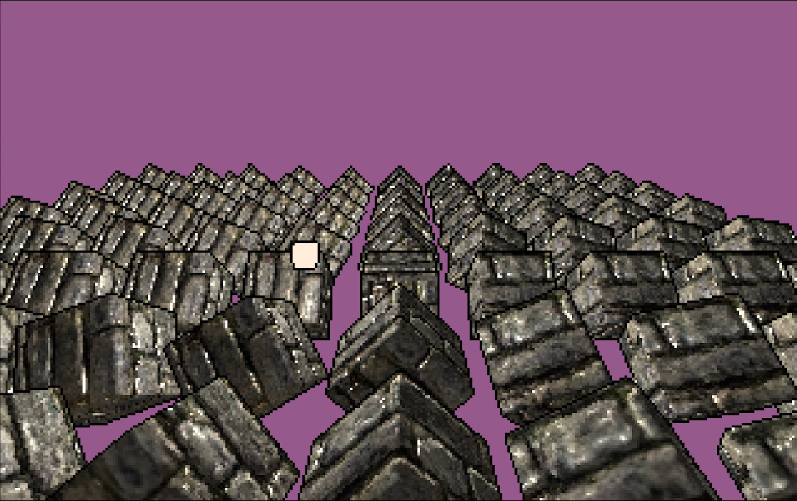
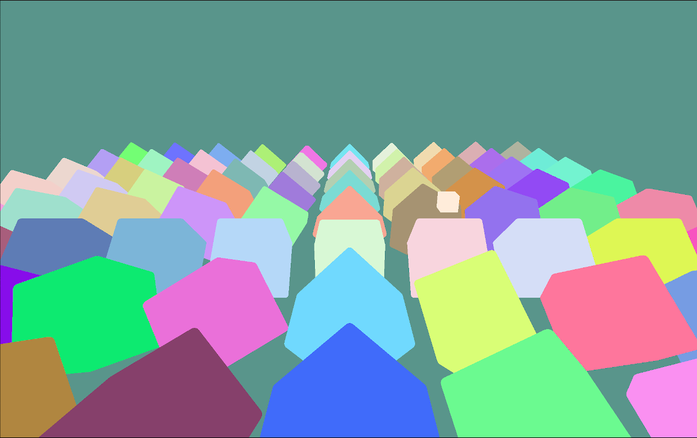
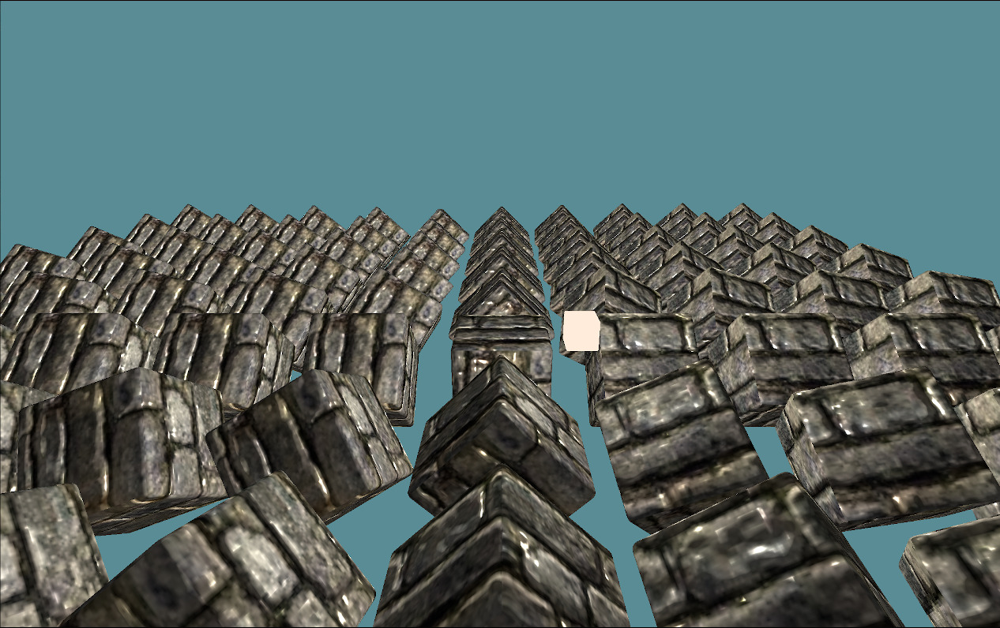
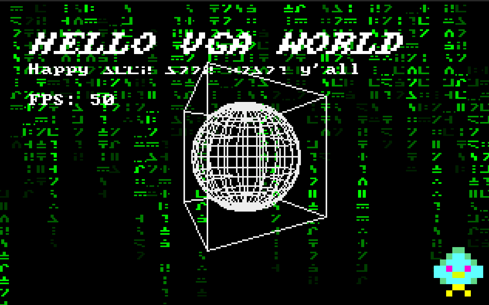

# Retro

This project is a small retro game and graphics experiment.
Its goal is to explore rendering techniques, game mechanics,
and visual aesthetics inspired by classic games of the VGA era.

## Getting Started

1. Clone this repository.
2. Build the project and run it.

## `sillyecs` + `winit` + `wgpu`

The newer example contains an archetype-based ECS with windowing provided
by `winit` instead of `minifb`. Rendering is performed using `wgpu` by targeting an
VGA-sized (320x200) offscreen texture, then linearly sampling to fullscreen. The
VGA upsampling shader provides some contour rendering for less pixel mess.

Hardware instancing is used to render identical entites in batched calls.

## Screenshots

The VGA shader "upsamples" from a 320x200 pixel render target and incorporates
depth information and entity IDs for edge detection and outlining:



Entity information is written to another texture during the first pass rendering:



Rendering can be done to a screen-sized buffer as well:



## Prior Retro Example

## Features

- Retro-style graphics rendering, including effects like fire, plasma, and matrix rain.
- Simple game mechanics for experimentation with objects such as cubes and spheres.
- Blending of game visuals with 2D rendering techniques such as sprite blitting and font rendering.

## Screenshot



### Dependencies

- Rust programming language (version 1.85.1 or higher recommended).
- Uses the following crates for functionality:
    - `minifb`: For window management and pixel-based rendering.
    - `rand`, `fastrand`: For randomness in game logic.
    - `spin_sleep`: To control timing and frame rate.
    - `tracing` and `tracing-subscriber`: For logging and debugging.
    - `rayon`, `crossbeam`: Parallel processing enhancements.

### How to Run

1. Install Rust if you have not already: [https://rustup.rs/](https://rustup.rs/)
2. Build and run the project:
   ```bash
   just run
   ```

## Acknowledgments

- Inspired by retro games and the creative techniques used to build them.
- Shout out to the Rust game development and graphics programming community for libraries and support.
